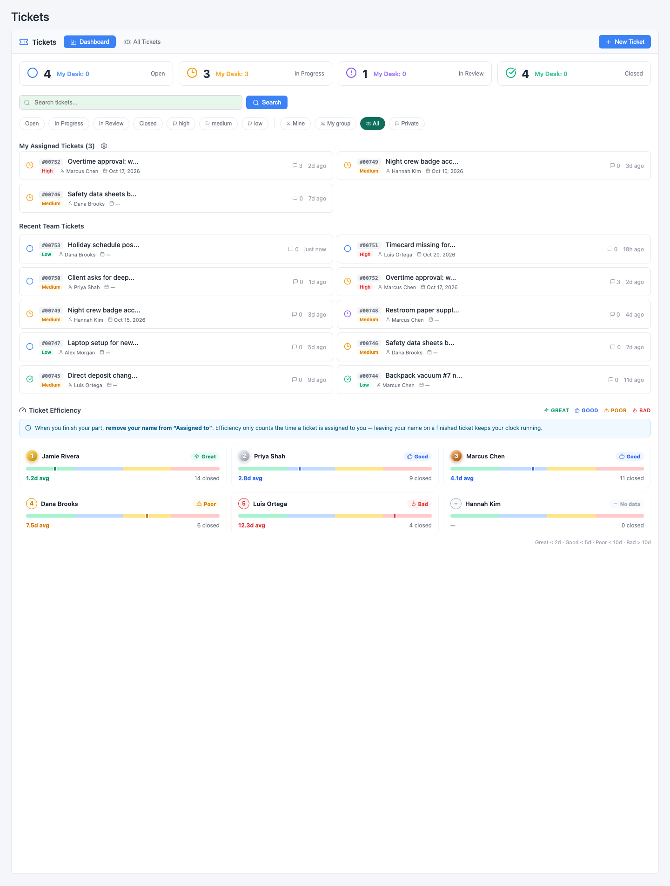
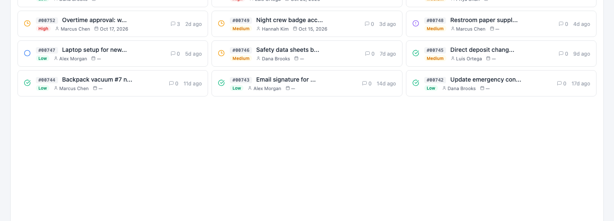
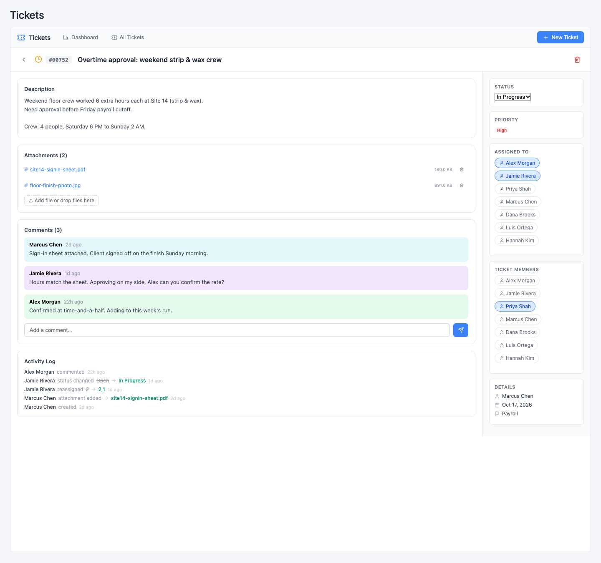
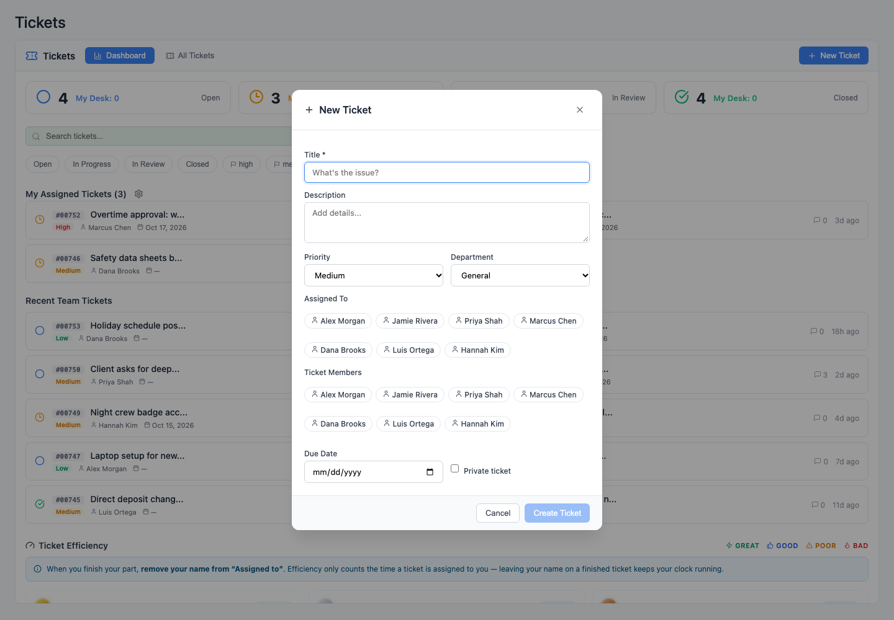

# System: Support Ticket System

Full internal helpdesk / support ticket system. Authenticated users open tickets, exchange threaded **comments**, attach **multiple files**, and admins triage with **assignees, members/watchers, priorities, departments, configurable statuses, time tracking, an activity log, and stats**. Status changes, assignment, and updates fire **email + in-app + push notifications**. Tickets can be **private**, carry **due dates** with overdue reminders, and are scoped by **role-based visibility levels**. The admin lands on a **dashboard** with per-status stat cards, **saved-per-user filters** (status, priority, and a Mine / My group / All / Private scope), and a **ticket efficiency meter** that scores how long closed tickets stayed assigned to each person. A **"Needs attention" sidebar alert** shows each user their overdue assigned tickets everywhere in the portal, refreshed live. Ticket numbers come from a dedicated **sequence table**, optional features (time logging) sit behind **feature flags**, and mobile users get **push events** for assignment, membership, updates and due/overdue dates.

**Type:** full feature subsystem (tickets + 6 child entities + number sequence + feature flags + configurable settings + per-user preferences + dual API + admin/mobile UI + notifications + live attention alert).

> **Last reviewed against the reference build:** 2026-10-19 (Alta Apps portal).

**Reference implementations:**
- **A — Alta Apps (richer, this build):** PHP + MySQL + React admin UI (`tickets-ui`) + JWT mobile API + S3-style object storage + push (Expo/FCM). The feature-complete reference.
- **B — Trados (simpler origin):** FastAPI + MySQL + React. Minimal 3-status single-thread variant (see history) — a subset of this spec.

> ## ⚠️ Integration target: demelos.com admin portal
> This ticket system is **not a standalone app** — it must be **fully integrated into the demelos.com admin portal** (the [admin-portal-system](../admin-portal-system/SPEC.md) chassis: Express + TypeScript + MySQL + React), sharing that portal's auth/roles, layout/sidebar, design tokens, notification stack, and `uploads/` storage.
>
> The demelos admin already ships a native ticket module to build on/reconcile with:
> - `backend/src/routes/tickets.ts` — Express/TS routes
> - `frontend/src/pages/Tickets.tsx` + `tickets.css` — React admin UI
> - `sql/02-tickets-v2.sql` — MySQL schema
> - `uploads/tickets/<ticket_number>/` — attachment storage on disk
>
> When porting the Alta (PHP) feature set below, **fold it into that Express/TS module** — do not add a parallel PHP service. Match the portal's `requireAdmin()` gating, envelope helpers, and settings singleton. Reference DDL in [reference/schema.sql](reference/schema.sql) is the target-shape schema; align `02-tickets-v2.sql` to it.

> **Related:** notifications reuse [email-template-system](../email-template-system/SPEC.md): events `new_ticket` / `update_ticket` / `private_ticket` map to the `ticket_new` / `ticket_edit` templates, with per-event owner / assigned copies (§8.1). Push uses the mobile token store (§8.2).

> **Stack-neutral:** field names below follow the MySQL reference. Substitute "user" / "tenant" / "company" for the target's noun.

---

## Visual Reference

Screenshots of the reference build's React admin UI (`tickets-ui`), rendered with **invented demo data**: every name, ticket and comment is fictional. Use them as the visual guideline for re-implementation.

| View | Preview |
|------|---------|
| Dashboard: per-status stat cards with "My Desk" counts, search, filter bar (status · priority · scope), My Assigned Tickets, Recent Team Tickets in two columns, efficiency meter with medals (§11.1, §13, §14) |  |
| All Tickets: search, filter bar, order select, ticket cards in a grid (§11.2) |  |
| Ticket detail: description, attachments (drop zone), per-author tinted comments, activity log, sidebar with status, priority, Assigned To / Ticket Members chips, details (§11.4) |  |
| New Ticket modal: title, description, priority, department, assignee and member chips, due date, private flag (§11.5) |  |

---

## Integration Prompt

> Paste everything below this line into the target project. Swap "user/tenant" for the right noun. Single-tenant apps can flatten the visibility levels to admin-vs-owner.

---

You are given a task to build a **support ticket / helpdesk system** in the codebase.

Reference stack (map onto project equivalents):
- **Backend:** PHP + MySQL (reference A) or FastAPI + MySQL (reference B). A data-access class exposes the public interface in §9.
- **Frontend:** React admin UI + (optional) a mobile/JWT client. Shared API client, toast notifications.
- **File storage:** S3-compatible object storage; DB stores attachment metadata + `object_key`, presigned URLs generated on read.
- **Notifications:** existing email template system + in-app notifications + push tokens.

### 1. Overview / Roles

- **End user / requester** → creates tickets, sees tickets they created / are assigned to / are a member of. Comments, uploads, deletes own comments. Cannot reassign or close (unless permitted).
- **Assignee** → a user the ticket is assigned to (many per ticket; first = primary). Gets push on assignment.
- **Member / watcher** → a collaborator added to a ticket without being the assignee. Gets push on add + on updates.
- **Admin (level ≤ 1 = super admin)** → sees ALL tickets, triages, reassigns, changes status, logs time, manages settings.

Each ticket has a sequential **ticket number**, a single chronological **comment** thread, **multiple attachments**, an **activity log**, optional **time entries**, a **priority**, a **department**, a **configurable status**, an optional **due date**, and an `is_private` flag.

### 2. Architecture

| Component | Responsibility |
|-----------|----------------|
| Ticket store | `tickets` table — core fields + audit. Sequential `ticket_number`. |
| Child stores | `ticket_assignees`, `ticket_members`, `ticket_comments`, `ticket_time_entries`, `ticket_activity_log`, `ticket_attachments`. Loaded in one batched pass per list (avoid N+1). |
| Settings store | `ticket_settings` — admin-editable statuses, priorities, departments with `label`, `color`, `sort_order`. Seeded with defaults if empty. |
| Object storage | S3-style. Attachment bytes live there; DB holds metadata + `object_key`. Presigned URL on read (`attachment_url`). |
| Filter translator | Portable filter-array DSL (`$in`/`$nin`/`$or`/`$and`/`$text`) → SQL WHERE + JOINs. Lets one query layer serve both reference stacks. |
| Notification hooks | Email templates + in-app notifications + push (`push_send_to_users`). Fire on create / assign / member-add / update / status-change. |
| Preference store | `ticket_user_prefs` — one JSON row per user holding their dashboard filters, scope and layout. Written on every change (debounced), read on load, so a user's view follows them to any browser. |
| Efficiency scorer | Replays each closed ticket's `reassigned` activity rows to credit elapsed time to whoever was assigned during each segment, then bands the per-user average. |
| Number sequence | `ticket_numbers` — an auto-increment table. Each create inserts a row and uses its id as `ticket_number`, so numbering is independent of `tickets.id` and survives imports (§3.9). |
| Feature flags | `ticket_features` — `feature_key` → `enabled`. Gates optional features (time logging) from the settings page without a deploy (§3.10). |
| Attention counter | A small read endpoint (`overdue_counts`) returning the caller's overdue assigned tickets, polled by the portal-wide sidebar alert (§16). Computed on read, never stored. |
| Notification helpers | Session-free functions (`notify`, `notifyOwner`, `notifyAssigned`, push sender) loadable by both APIs, so the web and mobile paths send the same notifications (§8). |
| Dual API | Admin API (session auth) + user/mobile API (JWT auth), mirrored action logic. |

### 3. Domain Model

**3.1 Ticket** — `tickets`:

| Field | Description |
|-------|-------------|
| `id` / `_id` | Identifier. |
| `ticket_number` | Sequential int, zero-padded for display (`#00042`). |
| `title` | Required. |
| `description` | Body. |
| `department` | From `ticket_settings` (default `General`). |
| `priority` | `low` \| `medium` \| `high` (configurable; default `medium`). |
| `status` | Configurable; defaults `open` \| `in_progress` \| `in_review` \| `closed`. |
| `is_private` | Bool. Restricts visibility + flips notifications to the `private_ticket` template. |
| `due_date` | Optional date. Drives due/overdue reminders and the attention alert. Store as `DATE` (the reference build used `VARCHAR(20)`, which truncated a mobile ISO timestamp and forces `LEFT(due_date,10)` everywhere). |
| `created_by` / `created_by_name` | Requester. |
| `created_at` / `updated_at` | Audit. `updated_at` bumped on every child write. |
| `closed_at` / `closed_by` / `closed_by_name` | Stamped when status → `closed`. |
| `reminder_sent` / `overdue_sent` | Flags so due-date reminder + overdue cron fire once each. |

**3.2 Assignees / Members** — `ticket_assignees`, `ticket_members` (both `ticket_id, user_id, user_name`). Many-to-many. Primary assignee = first. Members = watchers/collaborators.

**3.3 Comment** — `ticket_comments`: `id, ticket_id, author_id, author_name, content, created_at`. Plain text. The conversation thread.

**3.4 Time entry** — `ticket_time_entries`: `id, ticket_id, logged_by, logged_by_name, duration_minutes, description, logged_at`. Time tracking per ticket.

**3.5 Activity log** — `ticket_activity_log`: `id, ticket_id, actor_id, actor_name, action, old_value, new_value, created_at`. Actions: `created`, `status_changed`, `reassigned`, `members_changed`, `commented`, `time_logged`, `attachment_added`, `attachment_deleted`.

**3.6 Attachment** — `ticket_attachments`: `id, ticket_id, name, object_key, size, content_type, uploaded_by, uploaded_by_id, uploaded_at`. **Multiple per ticket.** Bytes in object storage; read via presigned URL.

**3.7 Setting** — `ticket_settings`: `id, type, value, label, color, sort_order`. `type` ∈ `status | priority | department`. Admin-editable; unique on `(type, value)`. Seeded defaults:
- **status:** open (`#3b82f6`), in_progress (`#f59e0b`), in_review (`#8b5cf6`), closed (`#10b981`)
- **priority:** low (`#059669`), medium (`#d97706`), high (`#dc2626`)
- **department:** General, IT, Sales, Operations, Finance

**Open statuses.** Define in one place which statuses count as "open" (reference: `open`, `in_progress`, `in_review`, `awaiting_customer`). The attention alert, mobile dashboard, reminders and home-page tiles all use that one list.

**Settings must drive the UI.** Status, priority and department pickers, pills, stat cards and the prefs allow-list read `ticket_settings` at runtime. Hardcoded lists drift: the reference build ended up with settings rows no screen showed and live values (`awaiting_customer`, a busy `Payroll` department) that settings didn't list.

**3.8 User preference** — `ticket_user_prefs`: `user_id` (PK), `prefs` JSON, `created_at`, `updated_at`. One row per user. Holds `filterStatus[]`, `filterPriority[]`, `filterScope`, `sortBy`, `columns`, `showTeam`. See §13.

**3.9 Ticket number sequence** — `ticket_numbers`: `id` (AUTO_INCREMENT PK), `created_at`. `createTicket` inserts a row and uses `insert_id` as `ticket_number`; rows are never deleted. Advantages: numbers don't depend on `tickets.id`, and a legacy range can be reserved before importing (the reference build bulk-inserted 601 rows so imported tickets kept numbers 0–672 and new ones start at 674). A failed create burns a number; that's acceptable.

**3.10 Feature flag** — `ticket_features`: `id`, `feature_key` (unique), `enabled`, `updated_at`. Reference flag: `time_logging` (off by default). Exposed to the UI at page load (`window.__TICKET_CONFIG__ = {time_logging}`) and toggled from the settings page.

### 4. Ticket Lifecycle

Statuses are **configurable** (not hardcoded), but the default flow:
```
(create) → open ──admin works──► in_progress ──► in_review ──► closed
                                     ▲                            │
                                     └──────── reopen (set status) ┘
```
- Status change writes a `status_changed` activity row (old → new).
- Setting status `closed` stamps `closed_at`, `closed_by`, `closed_by_name`. Re-opening clears them.
- Closing is reserved for super admins (`level <= 1`) on **both** APIs (the mobile API enforces this; enforce it server-side everywhere).
- Changing `due_date` re-arms the one-shot reminder flags (`reminder_sent = 0`, `overdue_sent = 0`) so the new date gets its own reminders.
- No auto-reopen; status is explicit. Comments are always accepted regardless of status.
- Validate a posted status against `ticket_settings` (§3.7).

### 5. Access Model & Visibility Levels

Role carries a numeric `level`. Lower = more powerful.
```php
function visibility_filter(int $level, int $uid): array {
    if ($level <= 1) return [];          // super admin → no filter, sees all
    return ['$or' => [
        ['created_by'   => $uid],
        ['assignee_ids' => $uid],
        ['member_ids'   => $uid],
    ]];
}
```
- **Super admin (`level <= 1`)** → sees/acts on every ticket.
- **Everyone else** → sees only tickets they created, are assigned to, or are a member of. Enforced on list (filter) AND on single-read (`user_can_see_ticket`) → 403/404 otherwise.
- **Private tickets** (`is_private`) further restrict + switch update notifications to the `private_ticket` template.
- **Every other place that counts or lists tickets applies the same visibility**: home-page tiles, mobile KPIs, "recent activity" feeds, the attention counter. A count query written outside the main API is the usual leak of org-wide or private data.
- **The module permission gates the API too**, not just the page that loads the UI.

**Filter syntax** (translated to SQL or Mongo): scalar equality, `$in`, `$nin`, `$or`, `$and`, `$text` (LIKE on title+description), plus `assignee_ids` / `member_ids`. Sort by `created_at` / `updated_at` / `ticket_number` / `due_date`. Pagination via `offset` + `limit`.

> ⚠️ **`assignee_ids` / `member_ids` must compile to `EXISTS`, never a `JOIN`.** Both bugs below were shipped and fixed in the reference build:
> - The filter nests (a scope clause AND the visibility clause both reference assignees), so a `JOIN` emits the same alias twice — `Not unique table/alias: 'ta'`, a hard 500 for every non-admin.
> - An inner `JOIN` inside an `$or` also drops tickets that have **no** assignee row at all, even when another branch of the `$or` (e.g. `created_by`) matches — so scoped users silently see *fewer* tickets than they are entitled to.
>
> ```sql
> EXISTS (SELECT 1 FROM ticket_assignees x WHERE x.ticket_id = t.id AND x.user_id = ?)
> ```
> An empty `$in` list must compile to a false constant, not to an empty `IN ()`.

### 6. Attachment Pipeline

1. Client POSTs `multipart/form-data` (`upload` action) with the file.
2. Validate type/size (extension allow-list + size cap).
3. Generate `object_key` (namespaced by ticket), upload bytes to object storage.
4. Insert `ticket_attachments` metadata row; write `attachment_added` activity; bump `updated_at`.
5. Read: `get` / `get_by_number` enrich each attachment with a short-lived **presigned URL** and an `is_image` flag, so the thread renders thumbnails without a second round trip. `attachment_url` returns a URL for a single key as a fallback.
6. **Gate attachment reads on the ticket's own visibility, not on a file-module permission.** Staff who legitimately see a ticket often have no rights in the general file browser; gating on the latter 403s them out of their own attachments.
7. Delete: `delete_attachment` first proves the `object_key` belongs to that ticket (same check as `attachment_url`), then removes the stored bytes and the row and writes `attachment_deleted` activity. Never pass a client-supplied key straight to storage delete.

Multiple attachments per ticket. Image types render inline as thumbnails; others as file chips. The UI opens files through the per-attachment `url` returned by `get`, never through a general file-browser endpoint (that endpoint requires a file permission ticket users often lack).

- **Unique keys per upload:** prefix the stored name with a uuid or timestamp (`tickets/<n>/<uuid>-<name>`). `{ticket}/{filename}` silently overwrites an earlier file with the same name.
- **One attachment store for every client.** The web and mobile apps must read and write the same table, or each client sees only its own files.
- The drop zone accepts several files at once and uploads them one after another.

### 7. Comments, Time Tracking, Activity

- **Comments** — add (`comment`) / list / delete. A non-author may delete only if super admin (`level <= 1`). Adding a comment writes a `commented` activity row + bumps `updated_at`.
- **Time entries** — `time_entry` action logs `duration_minutes` + description against the ticket; writes `time_logged` activity. Enables per-ticket effort reporting. Behind the `time_logging` feature flag (§3.10): when off, the UI hides the Time Logged card and the API refuses the action.
- **Activity rendering** — show people by **name**, not raw id lists, for `reassigned` / `members_changed`. Compare id **sets** when deciding whether those changed, so a reorder isn't logged as a change.
- **Activity log** — append-only, surfaced in the thread as a system timeline (who changed status, reassigned, added members, logged time, attached/removed files).

### 8. Notifications

Every channel fires from **both** APIs through the shared, session-free notification helpers (§2). A web action and the same action from the mobile app must notify the same people.

**8.1 Email** (via [email-template-system](../email-template-system/SPEC.md)). Events map to templates:

| Event | Fires on | Template (reference keys) |
|-------|----------|---------------------------|
| `new_ticket` | create of a public ticket | `ticket_new` |
| `update_ticket` | update that changed something | `ticket_edit` |
| `private_ticket` | create or update of a private ticket | `ticket_edit` |

- Recipients per event come from **Notification Settings**: a `notification_settings (event_type, user_id, enabled)` row per chosen user. Per-event toggles add the requester (`*_owner`) and the current assignees (`*_assigned`). Private tickets need their own owner/assigned toggles honoured, not the public ones.
- Template vars: `ticket_number` (`#00042`), `title`, `description`, `status`, `priority`, `department`, `due_date`, `created_by_name`, `assignee_names`, `member_names`, `is_private`, `url` (deep link `…/tickets.php?ticket=00042`). Escape **every** variable for HTML email, not only the description.
- The reference build redesigned `ticket_new` / `ticket_edit` (subject + body) on 2026-08-25; templates live in the DB, so they can change without a deploy.

**8.2 Push** (Expo / FCM, mobile tokens table). Events:

| Event | Recipients | Title |
|-------|------------|-------|
| `ticket_assigned` | newly added assignees | "Ticket assigned to you" |
| `ticket_member_added` | newly added members | "Added to a ticket" |
| `ticket_updated` | assignees ∪ members ∪ creator, minus the actor, minus anyone already pinged by the two events above; only when a ticket field changed (not on an assignee/member-only edit) | "Ticket updated" |
| `ticket_due` | assignees ∪ members, from the reminder cron | "Ticket due today" / "Ticket overdue" |

- Body `Ticket #N: <title>`; payload `{event, ticket_id}` so the app deep-links to the ticket.
- Gating: an org-wide row (`user_id = 0, enabled = 0`) turns an event off for everyone; a user row with `enabled = 0` opts that user out; no row means on. Users manage their own toggles in the app; admins get org toggles on the Notification Settings page.
- Send in batches (Expo: 100 per request, short timeout).

**8.3 In-app.** The live "Needs attention" counters (§16) are the in-app signal: computed on read, no stored feed to keep in sync.

**Rules.** **Never notify the actor about their own action**, on any channel (the owner and assigned copies included). Never send the same person two copies of one event. All sends are best-effort: a delivery failure must NOT roll back the ticket write.

**8.4 Due-date reminders.** A daily cron (08:00 local) scans open-status tickets (§3.7) with a `due_date`:
- due today and `reminder_sent = 0` → "Ticket due today" to assignees ∪ members (push + email), then `reminder_sent = 1`;
- past due and `overdue_sent = 0` → "Ticket overdue", then `overdue_sent = 1`.

Both flags re-arm when the due date changes (§4). Compare dates in the business time zone: the reference servers run UTC, so "today" rolled over at 18:00 Mountain. **Keep the cron script and its schedule in version control** (§17).

### 9. Data-Access Interface

A single class (`MySQLTickets` / `MongoTickets`) exposes a stack-agnostic interface — swap the storage engine without touching callers:
```
createTicket(doc) -> id
getTicket(id) -> ticket | null            # eager-loads all 6 child collections
updateTicket(id, fields, actorId) -> bool # diffs assignees/members, writes activity
deleteTicket(id) -> bool                  # cascades all child rows
listTickets(filter, sort, limit) -> []    # batched child load, no N+1
countTickets(filter) -> int
addComment(id, {author_id,author_name,content})
addTimeEntry(id, {logged_by,logged_by_name,duration_minutes,description})
addActivity(id, {actor_id,actor_name,action,old_value,new_value})
addAttachment(id, {name,object_key,size,content_type,uploaded_by,uploaded_by_id})
removeAttachment(id, object_key)
searchTickets(q, extraFilter) -> []       # $text on title+description
getStats(filter) -> { status: count }
getSettings(type) -> []
saveSetting(doc) -> id                     # upsert on (type,value)
deleteSetting(id)
nextTicketNumber() -> int                  # insert into ticket_numbers, return insert_id
getFeature(key) -> bool                    # ticket_features
setFeature(key, enabled)
countOverdueAssigned(userId) -> int        # open statuses, due_date < today, assigned to user
```

### 10. API Surface (dual: admin session + user/mobile JWT, mirrored)

**Admin API** (session auth) — `GET ?action=`:

| Action | Behavior |
|--------|----------|
| `list` | Tickets in caller's scope, with filters + sort + pagination. |
| `get` | One ticket + all children. |
| `get_by_number` | Lookup by `ticket_number`. |
| `attachment_url` | Presigned URL for an attachment `object_key`. |
| `stats` | `{status: count}` overall + "mine" (assigned to caller). |
| `search` | `$text` over title + description. |
| `employees` | Assignable users list (for assignee/member pickers). |
| `settings` | Get settings by `type` (status/priority/department). |
| `prefs` | The caller's saved dashboard preferences (`{}` on first use). |
| `efficiency` | Per-user closed-ticket efficiency (§14). Team-wide — deliberately ignores the caller's filters. |

`list` and `search` both accept `status`, `priority` (CSV) and `scope` (§13.2); `list` also takes `department`, `assignee`, `created_by`. Applying scope must never widen access — the visibility filter (§5) still runs on top of whatever scope returns. Paginate `list` (`offset` + `limit` with a total). A fixed cap silently truncates once the table outgrows it (the reference build capped at 500 with ~400 tickets live).

`get` / `get_by_number` return each attachment with a signed `url` (1 h) and `is_image`. `employees` returns active users `{id, name, email}` for the pickers.

`POST ?action=`: `create`, `update` (diffs status/assignees/members → activity + notifications), `comment`, `time_entry` (feature-flagged), `upload`, `delete_attachment`, `save_prefs`. `DELETE ?id=` deletes a ticket and all its children (super admin only). Every state-changing call carries a CSRF token (§15).

**User / mobile API** (JWT auth, `require_auth`) — mirrors admin logic, scoped by visibility level. Envelope `{success: true, data}` / `{success: false, error}` with real HTTP codes. Reference routing is `tickets.php` + `PATH_INFO`:

| Endpoint | Behavior |
|----------|----------|
| `GET tickets.php` | List visible tickets. `status` / `priority` CSV, `department`, `assigned_to`, `created_by`, `mine`, `search`; `page` (default 1) + `limit` (default 50, max 200). Returns `{items, total, page, limit}`. |
| `GET tickets.php?id=N` | One ticket (visibility-checked, 403/404). |
| `GET tickets.php/stats` | `{status: {total, mine}}` per status (visibility-filtered); optional `department`. Build the status list from settings. |
| `GET tickets.php/{id}/comments` | Comments, oldest first: `{id, ticket_id, user_id, user_name, body, created_at}`. |
| `POST tickets.php/{id}/comments` | Add comment (`{body}`); writes `commented` activity. |
| `DELETE tickets.php/comments/{commentId}` | Author or super admin; bumps `updated_at`. |
| `POST tickets.php` | Create: `title`, `description`, `department`, `priority`, `due_date`, `is_private`, `assignees[]` (or single `assigned_to`), `members[]`. Pushes `ticket_assigned` / `ticket_member_added`, never to the creator. |
| `PUT tickets.php?id=N` | Update the same fields. Due-date change re-arms reminders; closing requires `level <= 1`; writes `status_changed` / `reassigned` / `members_changed`; pushes per §8.2. Empty body → 400. |
| `DELETE tickets.php?id=N` | Super admin only; cascades children. |

Mobile ticket shape: `id`, `number` (unpadded string), `title`, `description`, `status`, `priority`, `department`, `created_by(_name)`, `assigned_to(_name)` (first assignee), `assignees[]`, `members[]`, `due_date`, `is_private`, `comment_count`, `created_at`, `updated_at`. Related mobile endpoints: per-user push toggles (`notifications.php`) and a dashboard (`open_tickets`, `my_tickets`, overdue / due-today alerts) that applies ticket visibility.

### 11. Admin UI

The admin UI is one React app mounted in the portal page (`tickets.php` → `#root`), with the signed-in user and feature flags injected as `window.__USER__ = {id, name, email, level}` and `window.__TICKET_CONFIG__`. Top bar: brand "Tickets", tabs **Dashboard** / **All Tickets**, and a **New Ticket** button. Deep link: `tickets.php?ticket=00042` opens that ticket (a leading `#` is tolerated).

**11.1 Dashboard** (landing view) — four stat cards (one per status, from settings) showing the org count plus the caller's own **"My Desk: N"** count; clicking a card sets that status filter and opens All Tickets. Search box + Search button. The filter bar (§13). Then **"My Assigned Tickets (N)"** (open tickets assigned to me, or the selected statuses), and a second list whose title follows the scope ("Recent Team Tickets" / "Tickets I'm Part Of" / "My Private Tickets"). Under scope *Mine* the second list is hidden — it would only repeat the first. A gear opens **Dashboard Settings**: order by (Newest first / Oldest first / Priority high → low / Recently updated), 1–3 columns, show/hide the second list. Bottom: the efficiency meter (§14).

**11.2 All tickets** — search (title + description; debounce ~300 ms, refetching only the list, not stats or employees), Clear, the same filter bar, an **Order** select, and a grid of **ticket cards**. Each card shows a status icon in its colour, `#00042` + truncated title, priority badge, requester, due date, logged time (when time logging is on), comment count and age. Card → ticket detail. Switching between dashboard and All Tickets must **not** reset the filters.

**11.3 Settings page** (`ticket_settings.php`, admin only) — an Add / Edit form (Type, Label, Value key, Color, Order) and a **Features** card (Time Logging switch, §3.10), then three tables (Statuses, Priorities, Departments): coloured label badge, value, colour swatch, order, Edit / Delete (confirm). Seeds defaults for any empty type. Drives every status / priority / department pill and picker app-wide (§3.7).

**11.4 Ticket detail** — header: back, status icon, `#number`, title, and **Delete ticket** (super admin, with a "cannot be undone" confirm). Main column:
- **Description** (plain text, line breaks kept).
- **Attachments (N)** — drag-and-drop zone ("Add file or drop files here", several files at once); chips with name + size, delete with confirm; image attachments as thumbnails; open via the per-attachment `url` (§6).
- **Comments (N)** — one card per comment, tinted per author (stable hue from the author id), author + age; single-line "Add a comment…" + Send (Enter submits); delete for the author or a super admin.
- **Activity Log** — newest first: actor · action · old → new · age, with people shown by name (§7).

Sidebar cards: **Status** select (posts on change), **Priority**, **Time Logged** (flag-gated: total, entries, minutes + note + Log), **Assigned To** and **Ticket Members** (a toggle chip per active user; each toggle saves immediately), **Details** (requester, due date, department). Editing title, description, priority, department, due date and the private flag (by the creator or a super admin) belongs here as well; the mobile app already offers edit and privacy controls.

**11.5 New Ticket modal** — Title * ("What's the issue?"), Description, Priority (Low / Medium / High), Department (from settings), Assigned To and Ticket Members chip pickers, Due Date, "Private ticket" checkbox; Cancel / **Create Ticket** (disabled until there is a title).

**11.6 Portal home** — a "Tickets / Mine" tile and a **My Tickets** card (my five newest open assigned tickets with priority and status badges, View All). Both apply ticket visibility (§5).

**11.7 Mobile/user client** — Tickets tab with a dashboard / list toggle, the four status cards (total + mine), search, My Assigned Tickets; detail with status, assignee and member sheets, privacy toggle, comments (with delete) and attachments; create and edit screens; push deep links (`ticket_id`, §8.2).

### 12. Reference Schema (MySQL DDL)

Exact build-ready schema — full file: [reference/schema.sql](reference/schema.sql) (InnoDB, utf8mb4; includes the seed `INSERT` for default statuses/priorities/departments). Core tables:

```sql
CREATE TABLE `tickets` (
  `id`              INT UNSIGNED NOT NULL AUTO_INCREMENT,
  `ticket_number`   INT UNSIGNED NOT NULL,
  `title`           VARCHAR(500) NOT NULL,
  `description`     TEXT,
  `department`      VARCHAR(100) DEFAULT 'General',
  `priority`        ENUM('low','medium','high') NOT NULL DEFAULT 'medium',
  `status`          VARCHAR(50)  NOT NULL DEFAULT 'open',  -- value from ticket_settings
  `is_private`      TINYINT(1)   NOT NULL DEFAULT 0,
  `due_date`        DATE,                                  -- ref build: VARCHAR(20); use DATE
  `created_by`      INT NOT NULL DEFAULT 0,
  `created_by_name` VARCHAR(255),
  `closed_at`       DATETIME, `closed_by` INT, `closed_by_name` VARCHAR(255),
  `created_at`      DATETIME NOT NULL DEFAULT current_timestamp(),
  `updated_at`      DATETIME NOT NULL DEFAULT current_timestamp() ON UPDATE current_timestamp(),
  `reminder_sent`   TINYINT(1) NOT NULL DEFAULT 0,         -- due-date cron, one-shot
  `overdue_sent`    TINYINT(1) NOT NULL DEFAULT 0,         -- overdue cron, one-shot
  PRIMARY KEY (`id`), UNIQUE KEY `uq_ticket_number` (`ticket_number`),
  KEY (`status`), KEY (`priority`), KEY (`department`), KEY (`created_by`), KEY (`created_at`)
) ENGINE=InnoDB DEFAULT CHARSET=utf8mb4;
```

Child tables (full DDL in the .sql file):
- `ticket_assignees` / `ticket_members` — `(ticket_id, user_id, user_name)`, unique `(ticket_id,user_id)`, indexed both ways.
- `ticket_comments` — `(ticket_id, author_id, author_name, content TEXT, created_at)`.
- `ticket_time_entries` — `(ticket_id, logged_by, logged_by_name, duration_minutes, description, logged_at)`.
- `ticket_activity_log` — `(ticket_id, actor_id, actor_name, action, old_value, new_value, created_at)`.
- `ticket_attachments` — `(ticket_id, name, object_key VARCHAR(1000), size, content_type, uploaded_by, uploaded_by_id, uploaded_at)`.
- `ticket_settings` — `(type, value, label, color, sort_order)`, unique `(type,value)`, indexed `type`.
- `ticket_user_prefs` — `(user_id PK, prefs JSON, created_at, updated_at)`. Per-user dashboard filters/scope/layout (§13.3).
- `ticket_numbers` — `(id AUTO_INCREMENT PK, created_at)`. Ticket number sequence (§3.9).
- `ticket_features` — `(id, feature_key UNIQUE, enabled, updated_at)`. Feature flags (§3.10), seeded with `time_logging = 0`.

Shared tables the module uses: `notification_settings (event_type, user_id, enabled)` for email recipients, org toggles and push opt-outs; the mobile push-token table; `email_templates`; the users/permissions tables. An imported legacy dataset may still carry `mongo_id` columns; the target schema drops them, so remove every code reference to them in the same change.

> Document-store equivalent: collapse the child tables into embedded arrays on the ticket document (`comments[]`, `time_entries[]`, `activity_log[]`, `attachments[]`, `assignee_ids[]`, `member_ids[]`); keep `ticket_settings` a small collection. The data-access interface (§9) is identical either way.

### 13. Filters, Scope & Saved Preferences

**13.1 Filter bar.** One shared component, rendered identically on the dashboard and the inbox, so a selection means the same thing in both places:

| Group | Behaviour |
|-------|-----------|
| Status | Multi-select chips, one per configured status (Open / In Progress / In Review / Closed). |
| Priority | Multi-select chips (high / medium / low), tinted with the priority colour when active. |
| Scope | **Single** choice — visually separated (divider + a distinct active colour) so it doesn't read as another toggle. |
| Clear | Appears only when something is set; resets status, priority and scope. |

**13.2 Scope.** Sent as `scope=` on `list` and `search`:

| Scope | Meaning | Filter |
|-------|---------|--------|
| `mine` | Tickets assigned to me | `assignee_ids = uid` |
| `group` | Tickets I'm a member of | `member_ids = uid` |
| `all` (default) | All public tickets | `is_private = 0` |
| `private` | My private tickets | `is_private = 1` AND (`created_by` \| `assignee_ids` \| `member_ids` = uid) |

`private` **must** carry the ownership clause. Without it a super-admin (who has no visibility filter) would see everyone's private tickets under a scope labelled "my private tickets".

**13.3 Persistence.** Filters and layout auto-save — no save button:

- Debounce writes (~600ms) so a burst of chip clicks is one round trip.
- Persist **server-side**, keyed by user, so the view follows them to another browser or device. `localStorage` is only a first-paint cache to avoid a flash of unfiltered content.
- Do not save until the initial load has completed, or the defaults will overwrite what was stored.
- `save_prefs` **allow-lists every key and every value** (status values, priority values, scope, sort mode, column count 1–3, boolean) and silently drops anything else. The client never dictates what lands in the database.
- Migrate old shapes on read — the reference build carried a boolean `filterMine` before scope existed, and maps `true → mine` on load.

### 14. Efficiency Meter

Scores how long closed tickets stayed assigned to each person. The point is behavioural: it makes leaving your name on finished work visible, so the UI ships an explicit reminder — *"when you finish your part, remove your name from Assigned to; efficiency only counts the time a ticket is assigned to you."*

**14.1 Scoring.** Time is credited **per person, not per ticket**. A ticket's assignee set changes over its life, so each closed ticket is replayed as a series of segments:

1. Take closed tickets. Use `closed_at`, falling back to `updated_at` where the column was populated later (don't silently drop the older rows).
2. Read that ticket's `reassigned` activity rows (oldest first). Each stores the old and new assignee id lists.
3. The set in place before the first change is that row's `old_value`. With no history at all, the current assignees held the ticket for its whole life.
4. Walk creation → each event → close, crediting each segment's elapsed seconds to every user holding the ticket during it. Clamp event timestamps into the ticket's own lifetime.
5. Per user: average their credited seconds over the tickets they held. Users with none report "no data" rather than scoring zero.

**14.2 Bands.** Thresholds in **days of assigned time**, defined in one constant and returned to the client so the UI never hardcodes them:

| Band | Default | Colour | Icon |
|------|---------|--------|------|
| Great | ≤ 2d | green | zap |
| Good | ≤ 5d | blue | thumbs-up |
| Poor | ≤ 10d | amber | warning triangle |
| Bad | > 10d | red | flame |

**14.3 UI.** A card per user, ranked best → worst, each carrying its **placing in a circle** (1, 2, 3…) before the name — the top three wear a gold / silver / bronze medal disc (metallic gradient, white numeral - not emoji, so it renders identically everywhere), and the rest are outlined in their band colour. Users with no closed tickets show a muted dash instead of a number: no data is not last place. Then: name, band chip (colour + icon), a four-zone meter bar with a marker positioned by band (each band owns a fixed quarter of the bar, so someone far past the last threshold doesn't distort it), the average in days, and the ticket count the score rests on. The legend and the threshold scale are printed alongside so the number is self-explanatory. The meter is **team-wide** — it deliberately ignores the dashboard filters.

**14.4 Exclusions & honesty.** Service accounts are excluded by id (the reference build hides an "Apple" App Store review account). Accuracy is bounded by how far back the `reassigned` history goes: tickets closed before assignment history existed credit their whole lifetime to the current assignees, which inflates early averages. Say so in the UI or the rollout note rather than presenting the number as exact.

**14.5 Audience & cost.** The meter is shown to every ticket user (it's meant to be visible), and the reference build recomputes it from all closed tickets on each dashboard load. That is fine at a few hundred closed tickets; past that, cache the result (e.g. recompute on close or hourly).

### 15. Security Rules

- Visibility enforced on BOTH list (filter) and single-read (`user_can_see_ticket`) — non-privileged users get 403/404 for tickets they don't own/assign/member.
- Super-admin gate is `level <= 1`; everyone else is scoped.
- `created_by` / `tenant` set from the authenticated session, never the request body.
- Comment delete restricted to author or super admin.
- Attachments: extension allow-list + size cap; bytes in object storage; reads via short-lived presigned URLs; `object_key` namespaced by ticket (no cross-ticket guessing); empty/oversized rejected.
- Comments + descriptions rendered as plain text — no HTML eval (no XSS via ticket content).
- All SQL parameter-escaped (`mysqli_real_escape_string`) / prepared statements on the raw paths.
- Notification failures never roll back the ticket write.
- Scope (§13.2) narrows only — the visibility filter still runs on top of it, and the `private` scope carries its own ownership clause so a super admin cannot read other people's private tickets through it.
- `save_prefs` allow-lists every key and value; the stored JSON is app-owned, never a passthrough of the client payload.
- `assignee_ids`/`member_ids` compile to `EXISTS`, not `JOIN` (§5) — a nested filter otherwise 500s on alias collision or silently under-reports.
- Role rules run server-side on **both** APIs: closing and deleting need `level <= 1`; the private flag and members are changed by the creator or a super admin; the module permission gates every API action.
- CSRF tokens on every state-changing request of the session API and the settings page forms.
- Escape every template variable placed in HTML email (titles and names included).
- `delete_attachment` verifies the key belongs to the ticket before touching storage (§6).
- Error responses never include file paths, line numbers or SQL; log those server-side.
- Counts, tiles and activity feeds outside the main list apply ticket visibility (§5). Service accounts (e.g. an App Store review login) get the lowest privilege that demos the app, not super admin, so they can't read private tickets.
- No credentials in the repository; read them from the environment.

### 16. "Needs attention" Alert (overdue tickets, portal-wide)

A card under the portal logo in the sidebar, on every page, shows the signed-in user's urgent items. For tickets: **"N overdue ticket(s)"** linking to the tickets page, plus a red count badge on the Tickets menu item.

- **Count:** tickets **assigned to me**, in an open status (§3.7), with `due_date` before today (business time zone). Zero when the user lacks the tickets view permission.
- **Live:** the page polls a small endpoint (`overdue_counts`) every 60 s and when the tab regains focus, animates changes, respects reduced motion, and releases the session lock before querying so it never blocks other requests.
- **Shared box:** the same card carries other modules' urgent items (overdue tasks, proposals and site visits due within 48 h, expiring compliance documents), so it is built as a small registry of counters rather than ticket-only markup.
- **Preview:** `?alert_preview=1` (admins) renders sample counts without polling, for design review.
- The mobile dashboard shows the equivalent alerts (my assigned tickets overdue / due today) inside the app.

### 17. Operations & Lessons from the Reference Build

- **The UI is a build artifact.** Editing the React source does nothing until it is rebuilt and the hashed bundle is committed. A rebuild empties the output folder, so mirror it on deploy (`rsync --delete` or `rm -rf` first); a plain copy leaves stale bundles.
- **Keep every cron script, its schedule and every migration in version control.** The reference build's reminder cron lived only on the server and was erased by an `rsync --delete` deploy (2026-09-23), silently stopping due/overdue reminders. Code that runs in production but isn't in git will eventually be deleted by a deploy.
- **Know which folders a `--delete` deploy owns.** The mobile API was later brought into git and deployed without `--delete` for that reason.
- **Dates and time zones.** Store due dates as `DATE` and compute "today" in the business time zone; UTC servers roll the day over hours early.
- **Imports.** Reserve the legacy number range in the sequence table before importing, keep imported activity under its own action name (the reference build has a legacy `updated` action), and expect attachments without stored bytes.
- **Settings drift.** If a list is "configurable", every screen must read it (§3.7); otherwise drop the claim.

### Reproduction Checklist

1. Create `tickets` + 6 child tables (`ticket_assignees`, `ticket_members`, `ticket_comments`, `ticket_time_entries`, `ticket_activity_log`, `ticket_attachments`) + `ticket_settings`. Index `ticket_id` on every child; index `(status)`, `(ticket_number)` on tickets.
2. Seed `ticket_settings` defaults (statuses, priorities, departments) if empty.
3. Implement the data-access class (§9) with batched child loading (no N+1) and the filter translator (`$in/$nin/$or/$and/$text` + assignee/member joins).
4. Implement visibility (`level <= 1` = all; else created/assignee/member) on list + single-read.
5. Build the admin API actions (§10) incl. `attachment_url` presigning, `stats`, `settings`.
6. Build the JWT user/mobile API mirroring admin logic, scoped by visibility.
7. Wire the attachment pipeline to object storage (allow-list, size cap, presigned reads).
8. Wire notifications: email templates (`new_ticket`/`update_ticket`/`private_ticket` + owner), in-app, and push (`ticket_assigned`/`ticket_member_added`/`ticket_updated`, never the actor).
9. Write activity rows on every state change (status/assignees/members/comment/time/attachment).
10. Add the due-date reminder + overdue cron (one-shot via `reminder_sent`/`overdue_sent`).
11. Build the admin UI: inbox, settings page (color-coded statuses/priorities/departments), thread view (comments + activity timeline + assignees/members + time entries + multi-attachment).
12. Build the mobile/user client with push deep links.
13. Add `ticket_user_prefs` + the `prefs` / `save_prefs` actions; wire the shared filter bar (status, priority, scope) with debounced auto-save and an allow-listed write path (§13).
14. Add the `efficiency` action + meter: replay `reassigned` history to credit assigned time per user, band it, and show the "take your name off finished work" reminder (§14).
15. Add `ticket_numbers` (sequence, reserve any legacy range) and `ticket_features` (`time_logging`), with a Features card on the settings page (§3.9, §3.10, §11.3).
16. Wire push events `ticket_assigned` / `ticket_member_added` / `ticket_updated` / `ticket_due` with org + per-user opt-outs, from both APIs, never to the actor (§8.2); re-arm reminder flags on due-date change (§4).
17. Add the "Needs attention" sidebar alert: `overdue_counts` endpoint, 60 s polling + on focus, badge on the Tickets menu, preview mode (§16).
18. Commit the reminder cron and its schedule to the repo; deploy the UI bundle with a mirroring copy (§17).
19. Apply the security rules in §15: server-side role checks on both APIs, CSRF, escaped email variables, attachment-key ownership on delete, visibility on every count and feed.

---

## System Metadata

| Field | Value |
|-------|-------|
| Category | Support / helpdesk / ITSM |
| Backend | PHP + MySQL (ref A) or FastAPI + MySQL (ref B) |
| Frontend | React admin UI + JWT mobile client |
| Storage | S3-compatible object storage (presigned reads) |
| Entities | tickets + assignees + members + comments + time entries + activity log + attachments + settings + per-user preferences + number sequence + feature flags |
| Beyond the simple variant | ticket numbers (sequence table), priorities, departments, configurable color-coded statuses, assignees, members/watchers, time tracking (feature-flagged), activity log, multiple attachments, email + push (`ticket_due` included) notifications with org/per-user opt-outs, private tickets, due-date/overdue reminders with re-arm, stats, visibility levels, dual admin+mobile API, dashboard with saved-per-user filters + Mine/My group/All/Private scope, per-user efficiency meter with medals, portal-wide "Needs attention" overdue alert |
| Last reviewed | 2026-10-19 against the Alta Apps build |
| Multi-tenant | Role-based visibility levels + private tickets |
| Depends on | [email-template-system](../email-template-system/SPEC.md) — `new_ticket` / `update_ticket` / `private_ticket` / `support_reply` |
| **Integration target** | **Must be fully integrated into the demelos.com admin portal ([admin-portal-system](../admin-portal-system/SPEC.md), Express/TS/MySQL/React) — fold into its existing `tickets.ts` / `Tickets.tsx` / `02-tickets-v2.sql`, not a standalone service** |
| Source build | Alta Apps portal (`app.altajan.com`) — PHP/MySQL helpdesk |
